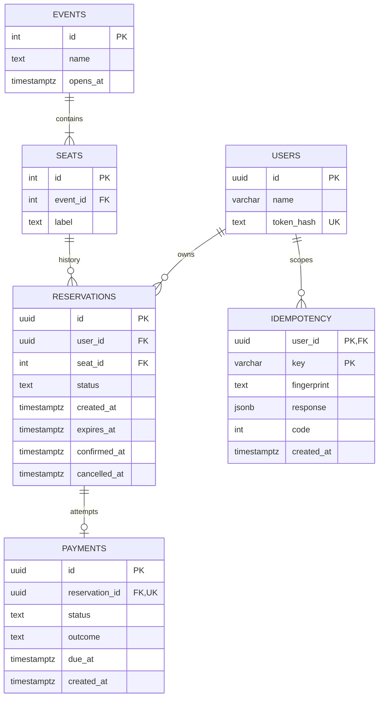
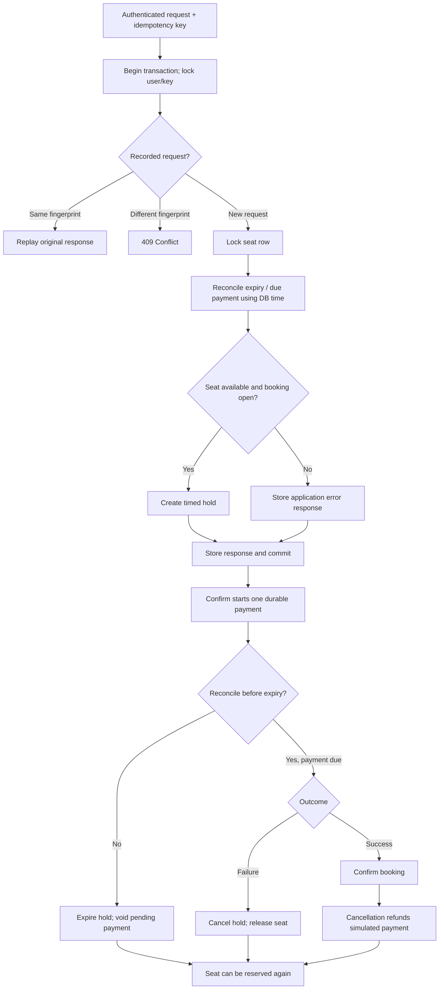
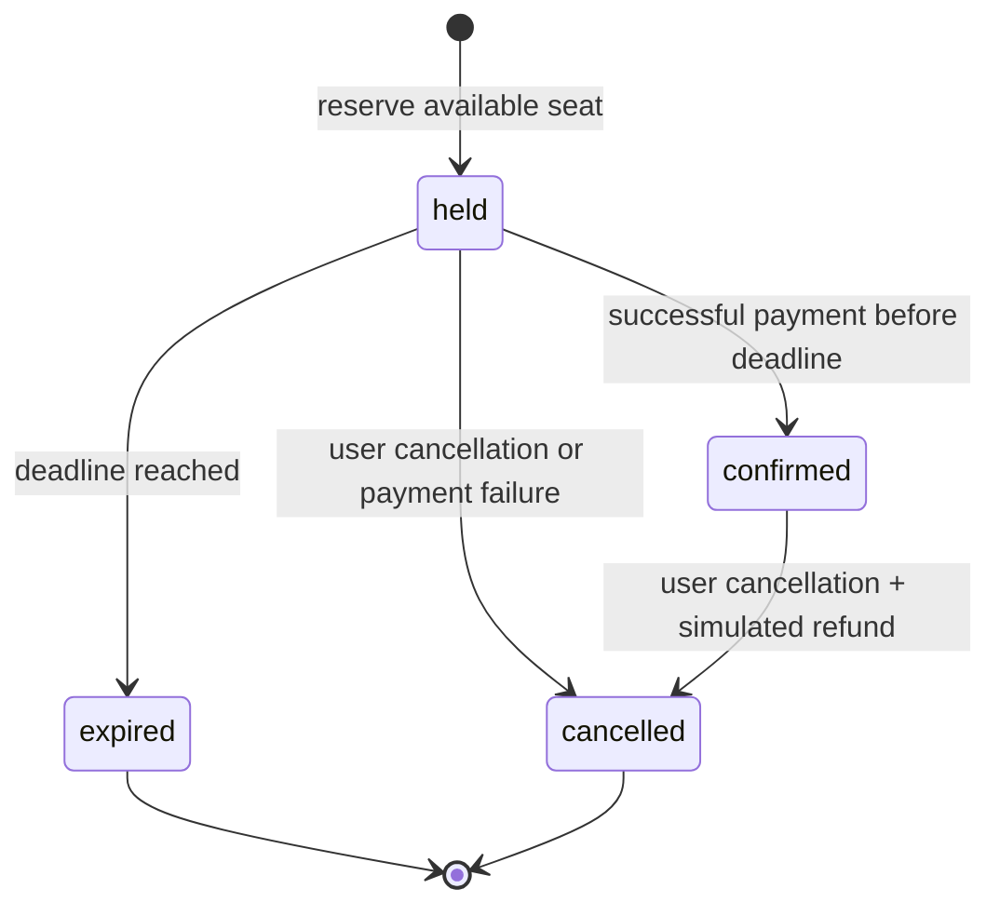

# Entity relationship diagram

Render these Mermaid diagrams directly on GitHub.

`seats(event_id,label)` is unique. A partial unique index allows only one `held` or `confirmed` reservation per seat. Idempotency has the composite primary key `(user_id,key)`.

# Booking workflow

# Reservation state machine

Reallocation creates a **new** reservation. No terminal reservation is reactivated.
